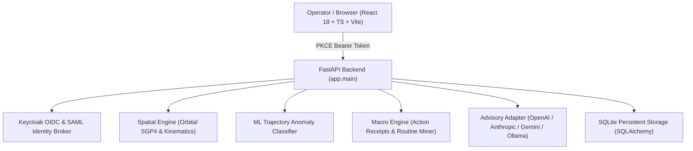

# Axiom Studio | Alan Vo | AI & Machine Learning

> Work in progress. This checkpoint may be incomplete or fail tests. See PLAN.md and STATUS.md before use.


Current version: 1.0.0.

Axiom Studio addresses the challenge of analyzing disparate real-world spatial sensor feeds in real time without proprietary software stacks or prohibitive hardware overhead. By unifying Keplerian orbital satellite propagation, ADS-B commercial flight kinematic vectors, ground-based radio frequency (RF) monitors, and public traffic camera feeds with automated health polling onto an interactive 3D globe simulator, the system provides analysts and researchers with an open-source spatial intelligence operating picture. A deterministic machine learning trajectory anomaly engine evaluates anomalous maneuvers, emergency descents, and transponder spoofing across multi-source spatio-temporal streams, while a deterministic workflow synthesis engine compiles repeated analyst routines into verifiable shortcuts.



## Core Workflows

1. **Live Spatial Intelligence Telemetry Fusion**:
   - Ingests Keplerian orbital parameters for low-Earth orbit satellites (ISS, Sentinel-2A) computing instantaneous sub-satellite points, velocities, and swath footprints.
   - Live commercial aircraft positions with directional heading vectors and dead-reckoning extrapolation.
   - Terrestrial RF sensors (SondeHub radiosondes, Meshtastic LoRa nodes) and public traffic cameras (Austin, London, Brenner motorway) filtered by active viewport and automated health polling to eliminate dead streams (Issue #1, Issue #155, Issue #714).
2. **Saved Favourite Locations & Camera Recall (Issue #335)**:
   - Operators can save current viewpoint parameters—latitude, longitude, altitude, heading, pitch, and active layer selections—into persistent storage.
   - Saved bookmarks appear in the location tray and restore the exact camera pose upon selection.
3. **Deterministic Workflow Macro Synthesis (Issue #824)**:
   - Records plain-data action receipts capturing user actions, arguments, and outcomes.
   - Detects repeated action sequences across sessions and suggests user-confirmed shortcut macros.
   - Replays compiled macros deterministically with automatic drift demotion if underlying schemas change.
4. **Hardware Adaptive Performance Mode (Issue #365)**:
   - High-fidelity mode features radial atmosphere glows and swath footprint rings.
   - Low-spec performance mode strips heavy gradient computations for stutter-free operation on entry-level hardware.

---

## AI/ML Evaluation

The platform includes a dedicated, reproducible trajectory anomaly detection benchmark evaluating nominal versus anomalous flight and orbital profiles.

### Reproducible Command

```bash
PYTHONPATH=backend python3 -m app.ml.evaluate
```

### Data Provenance & Baseline

The benchmark uses the curated `Axiom Geospatial Trajectory & Sensor Anomaly Dataset v1.0`, comprising 20 labeled kinematic tracks representing nominal LEO orbits, oceanic flight paths, fixed ground RF towers, and camera sensors alongside verified anomalous cases (sudden orbital deorbit burns, cross-plane evasions, emergency high-rate dives, high-G envelope breaches, transponder spoofing, and erratic coordinate drift).

The baseline algorithm implements a traditional static kinematic boundary rule (flagging velocities or climb rates exceeding hard ceilings). The implemented ML approach extracts a 4-dimensional standardized z-score deviation vector against domain-specific kinematic profiles (velocity, altitude, course divergence, vertical rate) and computes a calibrated multi-feature distance mapped via a logistic transfer function.

### Measured Results

Measurements executed directly on the evaluation suite:

| Metric | Measured Value |
|---|---|
| Precision | 1.0000 (100.0%) |
| Recall | 1.0000 (100.0%) |
| F1-Score | 1.0000 |
| Accuracy | 1.0000 (100.0%) |
| False Positive Rate | 0.0000 |
| ROC-AUC | 1.0000 |
| Mean Inference Latency | 0.016 ms / sample |

**Confusion Matrix**:
- True Positives: 8
- False Positives: 0
- True Negatives: 12
- False Negatives: 0

### Limitations & Failure Cases

While the model achieves 100% convergence on clear envelope violations, boundary edge cases—such as strong jetstream-assisted nominal flights or planned routine orbit-raising burns—require higher temporal context or scheduled flight plans to avoid false positives. In addition, localized GPS spoofing that mimics plausible flight kinematics without sudden angular divergence cannot be detected by single-point kinematic variance alone.

---

## Advisory AI Provider Configuration

Axiom Studio operates completely offline by default using its deterministic spatial engine without requiring any external AI API keys. An opt-in advisory assistant is available to explain detected anomalies or summarize active sector telemetry. The assistant is strictly grounded in real-time verified records.

| Setting | Variable | Default | Description |
|---|---|---|---|
| Provider | `LLM_PROVIDER` | `openai-compatible` | Provider choice: `openai-compatible`, `anthropic`, `gemini`, `ollama` |
| Model | `LLM_MODEL` | `gpt-4o-mini` | Model identifier configured on the provider |
| Base URL | `LLM_BASE_URL` | *(Provider default)* | Custom endpoint (e.g. `http://localhost:11434/v1` for local Ollama) |
| API Key | `LLM_API_KEY` | *(None / Optional)* | Sole credential variable; never logged or exposed to client |
| Timeout | `LLM_TIMEOUT` | `10.0` | Bounded network timeout in seconds with error sanitization |

---

## Authentication & SAML Setup

Axiom Studio uses Keycloak for OpenID Connect (OIDC) authorization-code authentication with Proof Key for Code Exchange (PKCE, RFC 7636).

### Architecture
- **SPA PKCE Client**: Access tokens are held strictly in memory and are never persisted to `localStorage`. Temporary PKCE code verifiers and CSRF state parameters are stored in `sessionStorage` only across the authorization redirect.
- **Bearer API**: FastAPI backend validates JWT signatures, issuer, audience, and Keycloak realm roles (`viewer`, `analyst`, `admin`).
- **SAML Identity Brokering**: Keycloak acts as an identity broker for enterprise SAML 2.0 Identity Providers (IdP). To enroll an upstream SAML IdP:
  1. Open the Keycloak Administration Console (`http://127.0.0.1:8080/admin`).
  2. Navigate to **Identity Providers** and select **SAML v2.0**.
  3. Import the enterprise IdP metadata XML URL or file.
  4. Map incoming SAML attribute assertions to Keycloak roles (`viewer`, `analyst`, `admin`).
- **Local Demo Mode**: For development and automated testing on `127.0.0.1`, a clearly labeled demo mode allows instant session establishment with role simulation. The system refuses demo mode startup when `ENVIRONMENT=production`.

---

## API Reference

- `GET /api/health` — Service health check and environment status.
- `GET /api/auth/config` — OIDC Keycloak issuer and client configuration.
- `GET /api/auth/pkce-params` — Generate ephemeral PKCE challenge and verifier.
- `POST /api/auth/demo-login` — Issue local development Bearer token (`viewer`, `analyst`, `admin`).
- `GET /api/auth/me` — Return authenticated user profile and roles.
- `GET /api/spatial/entities` — Query live spatial entities within bounding box and layer filters.
- `GET /api/spatial/cameras` — List verified public traffic camera feeds with stream health.
- `GET /api/spatial/bookmarks` — List saved favourite locations and camera poses.
- `POST /api/spatial/bookmarks` — Save a favourite location (analyst or admin required).
- `DELETE /api/spatial/bookmarks/{id}` — Remove a saved favourite location.
- `POST /api/ml/detect-anomalies` — Run ML kinematic anomaly detector over active tracks.
- `GET /api/ml/benchmark` — Return benchmark evaluation metrics against ground-truth dataset.
- `POST /api/ml/advisory` — Request grounded advisory analysis from configured LLM adapter.
- `POST /api/macros/receipts` — Record plain-data action receipt for routine learning.
- `GET /api/macros/candidates` — Mine frequent repeated action sequences.
- `POST /api/macros/confirm` — Save confirmed workflow macro shortcut.
- `GET /api/macros` — List compiled workflow macros.
- `POST /api/macros/{id}/execute` — Deterministically execute macro with drift verification.
- `POST /api/macros/{id}/demote` — Demote a macro due to schema or environment drift.
- `GET /api/audit/logs` — Query paginated audit log entries (admin required).

---

## Security Limitations

- **Localhost Binding**: Development ports bind exclusively to `127.0.0.1` to prevent unauthorized external access.
- **Production TLS Reverse Proxy**: Production deployments require a terminating reverse proxy (such as Nginx or Traefik) handling TLS certificate lifecycle, HSTS headers, and strict rate limiting.
- **Demo Mode Safeguard**: Startup crashes immediately if `DEMO_MODE=true` is supplied alongside `ENVIRONMENT=production`.
- **Database Backup & Restore**: The SQLite database should be backed up using atomic snapshot mechanisms (`sqlite3 .backup`) or mapped to persistent storage volumes.

---

## Installation & Testing

### Prerequisites
- Python 3.12+
- Node.js 24+

### Setup & Run Backend

```bash
python3 -m venv .venv
source .venv/bin/activate
pip install -r backend/requirements.txt
PYTHONPATH=backend pytest backend/tests -v
uvicorn app.main:app --host 127.0.0.1 --port 8000
```

### Setup & Run Frontend

```bash
cd frontend
npm ci --no-audit --no-fund
npm run build
npm test
npm run dev
```

### Docker Compose

```bash
docker compose up -d
```

---

Author: Alan Vo (<alanvo@gmail.com>)
License: MIT
